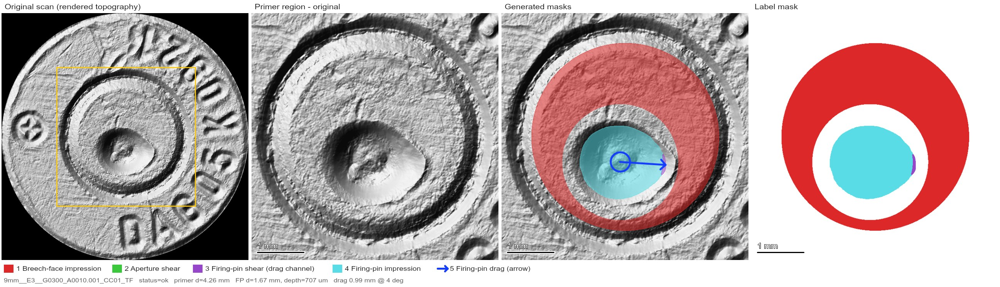
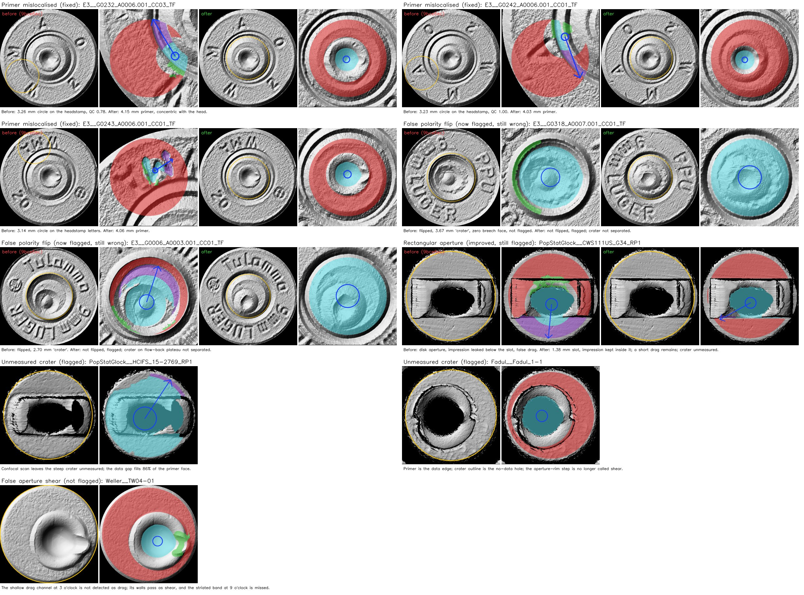

# Automatic masking of cartridge-case head scans

Cartmask detects the primer on a fired cartridge-case head and produces a label map, review overlay, and per-scan measurements. The calibrated workflow reads ISO 25178-72 X3P topography. An experimental image workflow supports rendered scans and the assignment figures.

This is the **TypeScript** implementation. It is a port of the Python reference implementation and produces the same masks: see [parity](#parity-with-the-python-reference).



| Label | Region | Default display | `--brief-colours` |
| ---: | --- | --- | --- |
| 1 | Breech-face impression | Red | Red |
| 2 | Aperture shear | Green | Green |
| 3 | Firing-pin shear (drag channel) | Purple | Light blue |
| 4 | Firing-pin impression (round strike) | Light blue | Purple |
| – | Firing-pin drag | Blue arrow | Blue arrow |

Both figures in the brief colour the round strike purple and the drag tail light blue. The default display reverses this on purpose, because the drag channel is where the pin shears the primer. `--brief-colours` reproduces the brief's figures exactly without changing label IDs. See [the colour convention](docs/method.md#colour-convention-the-briefs-figures-and-ours).

## What the brief asked for and where it is

| Brief item | Deliverable | Where |
| --- | --- | --- |
| Mask the breech-face impression, aperture shear, firing-pin shear and firing-pin impression; show the drag direction | Label map (0–4), per-region PNG masks, overlay with drag arrow, optional X3P with embedded mask | `npx tsx src/cli.ts`, [method](docs/method.md), [samples](samples/) |
| Work on real 3D scans | NIST NBTRD X3P topography, pinned by SHA-256 | [manifests](docs/scan-manifest.csv), [`scripts/fetch-nbtrd.ts`](scripts/fetch-nbtrd.ts) |
| Reproduce the brief's figures | 2D image mode on the brief's figures; colour switch | [2D results](docs/evaluation.md#2d-evaluation), `--brief-colours` |
| Show it works and where it fails | Results table, failure gallery, review reasons on every flagged scan | [Results at a glance](docs/evaluation.md#results-at-a-glance), [failure modes](docs/evaluation.md#known-failure-modes) |
| Multi-scan challenge | Batch command, replicate-scan consistency and consensus masks | [Many scans](docs/evaluation.md#many-scans-batch-processing-and-replicate-consistency) |
| Explain the approach | Method, design decisions and interview notes | [method](docs/method.md), [handoff](docs/handoff.md), [interview](docs/interview.md) |

## Quick start

Run from the repository root with Node 20 or newer.

```powershell
npm ci
npx vitest run                     # tests; real-scan parity tests skip without CARTMASK_DATA
npx tsx src/demo.ts                # offline: synthetic X3P heads -> outputs/demo
```

The demo writes three synthetic heads (dragged strike, round strike, cast with inverted heights) as X3P files and masks them with the normal batch command, so it produces the same files as real scans. Open [the report](report/index.html) in a browser for the 150-scan evaluation, the failure gallery and 15 cases in the interactive viewer. The report, [sample images](samples/) and [matching results](samples/matching/) need no download.

For the calibrated 3D workflow on NIST scans:

```powershell
npx tsx scripts/fetch-nbtrd.ts
npx tsx src/cli.ts data/raw -o outputs --x3p-masks
npx tsx scripts/build-report.ts
```

The fetcher downloads measurements by pinned NIST URL and verifies their SHA-256 checksums. The [baseline manifest](docs/scan-manifest.csv) lists 34 files representing 32 distinct scans. The [expanded manifest](docs/expanded-scan-manifest.csv) adds 118 distinct scans across four studies, for **150 distinct scans**. Raw data and full working outputs are excluded from Git.

```powershell
npx tsx scripts/fetch-nbtrd.ts --set all --verify-only       # verify 34 baseline files offline
npx tsx scripts/fetch-nbtrd.ts --set expanded --verify-only  # verify 118 expanded files offline
npx tsx scripts/audit-masks.ts --out outputs/audit/baseline-3d.json --compare-with samples/validation/baseline-3d.json
npx tsx scripts/rebuild-evidence.ts --out outputs/release
```

Each 3D result includes a side-by-side preview, region masks, a label image, `masks.json` with measurements, quality factors and `review_reasons`, and a row in `summary.csv`. The optional X3P export embeds a native-resolution mask while retaining the measured surface. See the [method and parameter guide](docs/method.md) for coordinate conventions, assumptions and handling of cropped or missing data. The npm scripts `cli`, `demo`, `audit`, `report` and `evidence` are shortcuts for the commands above.

## TypeScript and Python

The split is roughly 90 % TypeScript and 10 % Python by function: everything a user runs to get masks is TypeScript. (By line count it is closer to 80 / 20, because the experiments carry their own registration and statistics code.) X3P reading and writing, the 3D pipeline, the batch CLI and exports, the synthetic heads, the interactive report, the offline annotator, annotation scoring, the scan fetcher and the mask audit all run on Node with three small dependencies (`fflate`, `fast-xml-parser`, `@napi-rs/canvas`).

The remaining 10 % is Python, in [`python/`](python/): the research experiments that produce the evidence in [evaluation](docs/evaluation.md). These are the matching check (`python/compare.py`: band-pass, masked cross-correlation registration, cluster bootstrap, ROC plots), the 2D image mode and its benchmark (`python/image2d.py`, `python/benchmark_2d.py`) and replicate consistency (`python/replicate_consistency.py`). They lean on OpenCV, SciPy and matplotlib, and porting them would change the statistics being reported rather than the product. They do not segment anything themselves: they read the TypeScript CLI's `labels.png` and `masks.json`, so the evidence describes the masks this repository ships.

```powershell
python -m pip install -r python/requirements.txt          # Python 3.12
npx tsx src/cli.ts data/matching -o outputs/ts-matching -q
python python/compare.py outputs/ts-matching -o outputs/matching
python python/compare.py samples/matching/pairs.csv --summarize-only -o outputs/matching
```

`scripts/rebuild-evidence.ts` runs both halves and skips the Python steps with a message when Python is not installed.

## Parity with the Python reference

The port was accepted only when its masks matched the Python reference exactly. Measured result: **label grids identical to the Python reference on all 152 real scan files and 36 synthetic heads**, and the same geometry, QC scores, review decisions and review reasons.

The audit makes this checkable without the Python code. `scripts/audit-masks.ts` hashes the raw label bytes (uint8, row-major, specimen view, the bytes Python's `labels.tobytes()` hashes) and writes the audit in the reference's exact format. On the 34 baseline files it reproduces the committed [`baseline-3d.json`](samples/validation/baseline-3d.json) and [`current-3d.csv`](samples/validation/current-3d.csv) byte for byte, and on the 118 expanded files [`expanded-3d.csv`](samples/validation/expanded-3d.csv):

```powershell
$env:CARTMASK_DATA = "D:\path\to\data"; npx vitest run tests/audit.test.ts
npx tsx scripts/audit-masks.ts --data-root <data> --out outputs/audit/baseline-3d.json --compare-with samples/validation/baseline-3d.json
# Exact 3D mask parity on 34 files.
```

## Results

All numbers live in one table: [Results at a glance](docs/evaluation.md#results-at-a-glance). In short:

- Every one of the 150 distinct scans was processed; 149 returned masks and one firing-pin-only crop was skipped. Flagged scans carry a reason code such as `breech_face_too_small` or `crater_unmeasured`.
- On the downstream matching check, the breech-face mask does **not** beat the simple baseline on E3: AUC 0.975 for the mask against 1.000 for the full 5 mm crop centred on the detected primer (0.926 for the primer disc). An earlier claim that the mask ranked best was caused by a mislocalised primer and has been withdrawn. All three regions reach 1.000 on Fadul.
- Aperture shear is accepted only where striations run along the drag axis: the striated band is found on all 16 Lightstone scans, and rim steps on Fadul, Weller and E3 are no longer called shear. Glock slots are detected on 29 of 39 scans and none of the round-pin scans. See [aperture and shear](docs/aperture-and-shear.md).
- Masks of repeat firings agree after registration (mean IoU 0.83 on E3), and a majority-vote consensus mask is produced per firearm.
- Direct region accuracy on real scans still needs independent examiner labels. The [annotation packet](docs/annotation.md) is ready for that.

## Known failure modes



| Category | Cases | Status |
| --- | --- | --- |
| Primer mislocalised on the headstamp | E3 G0232 CC03, G0242, G0243 | Fixed by plausibility re-ranking |
| False polarity flip of a flow-back plateau | E3 G0006, G0318 | No longer flipped and now flagged; the crater on the plateau is still not separated |
| Unmeasured crater (confocal crops) | All PopStat Glock, Lightstone and Fadul scans | Flagged; outline from the data gap |
| Rectangular aperture | PopStat Glock | Improved: slot detected on 29 of 39 scans and excluded from the breech face; all still flagged |
| False aperture shear from an undetected drag | Weller TW04-01 | Open, not flagged |

In the author's own visual review of all 68 E3 full heads (not examiner labels), none of the 63 unflagged scans had a wrong primer, flip or missing crater, but about 9 had a visible region-boundary error, mostly an unlabelled drag tail or an oversized aperture zone. Details and per-case captions: [failure modes](docs/evaluation.md#known-failure-modes).

## 2D renders and annotation

```powershell
python python/image2d.py python/samples/brief/brief_p1_before.png -o outputs/2d
npx tsx scripts/build-annotator.ts data/raw -o report/annotator.html
npx tsx src/evaluate.ts --pred-from data/raw --truth annotations -o outputs/evaluation
```

The 2D workflow estimates visible regions from shading and geometry, without calibrated depth. It is weak: see the [2D evaluation](docs/evaluation.md#2d-evaluation), the [side-by-side result](samples/brief/brief_p1_before__side_by_side_2d.png) and the [reference comparison](samples/brief/brief_p1_compare.png). Use X3P for calibrated topography.

Open the [offline annotator](report/annotator.html) for the bundled scans. The [annotation guide](docs/annotation.md) covers independent labelling, export and scoring with per-class IoU, Dice, precision, recall and boundary F-score.

## Further reading

The [evaluation guide](docs/evaluation.md) covers sample composition, score interpretation and caveats. The [technical handoff](docs/handoff.md) explains the build rounds and major design choices. The [interview walkthrough](docs/interview.md) covers the live demo and follow-up questions.

Claude and Codex assisted with implementation, testing, review and documentation. See [citation metadata](CITATION.cff) for project and data attribution.
