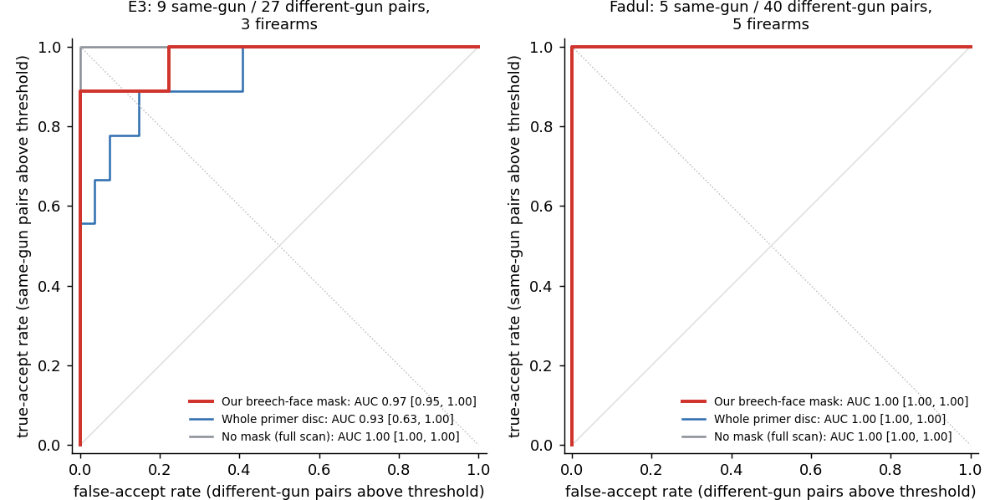
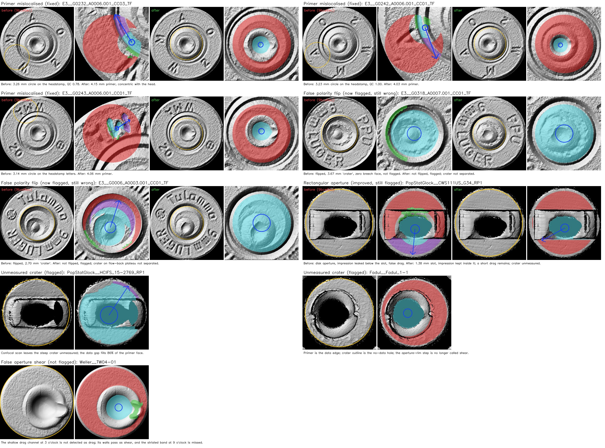
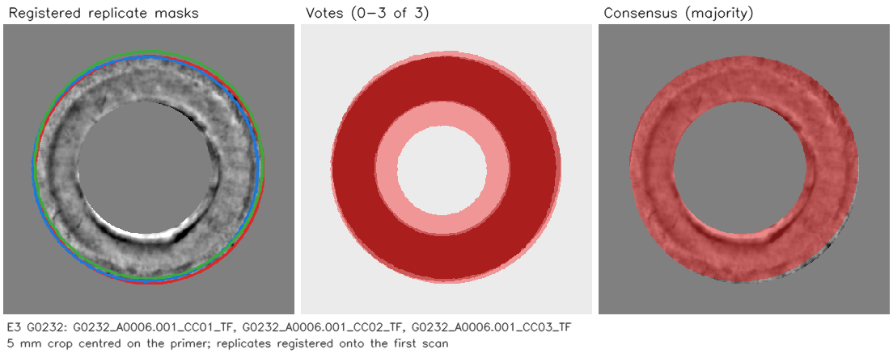

# Evaluation and limitations

## Results at a glance

This is the single results table; other documents link here instead of repeating the numbers.

| Evidence | Result | Source |
| --- | --- | --- |
| TypeScript port parity | Label grids identical to the Python reference on all 152 real files (34 baseline, 118 expanded) and 36 synthetic heads; the audit reproduces the committed fingerprints and review tables byte for byte | [Fingerprints](../samples/validation/baseline-3d.json), [README](../README.md#parity-with-the-python-reference) |
| 3D processing coverage | 150 distinct scans: 149 masks returned, 1 skipped (firing-pin-only crop), 70 flagged for review | [Original](../samples/validation/current-3d.csv), [expanded](../samples/validation/expanded-3d.csv) |
| Aperture shear and slot apertures | Lightstone striated band found on 16 of 16 scans (3 previously missed); rim-step "shear" removed on 10 of 11 Fadul, 8 of 8 Weller and 5 of 6 E3 files, 1 new false positive (Weller TW04-01); Glock slot detected on 29 of 39 scans and 0 of 113 round-pin scans; no review flag changed | [Aperture and shear](aperture-and-shear.md), [fingerprints](../samples/validation/baseline-3d.json) |
| Matching, E3 (9 same / 27 different pairs, 3 firearms) | AUC: breech face 0.975, primer disc 0.926, full 5 mm crop centred on the primer 1.000. The mask does not beat the crop | [Summary](../samples/matching/summary.json) |
| Matching, Fadul (5 / 40 pairs, 5 firearms) | AUC 1.000 for all three regions | [Summary](../samples/matching/summary.json) |
| Replicate breech-face mask IoU after registration | E3 0.83 (9 pairs), Fadul 0.82 (5), Weller 0.77 (6), Lightstone 0.67 (7) | [Consistency](../samples/replicates/consistency.json) |
| Silent failures, full-head E3 | Author's visual review of all 68 distinct E3 heads (not examiner labels): 0 of 63 unflagged scans with a wrong primer, flip or missing crater; about 9 of 63 with a visible region-boundary error. The shear and slot changes alter no E3 impression and only one E3 breech face below 0.98 IoU (G0002 CC01, false shear removed) | [Failure modes](#known-failure-modes) |
| 2D mode on the brief's figure 1 | Breech-face IoU 0.42; firing-pin impression missed | [Brief evaluation](../samples/brief/brief_eval.json) |
| 2D mode on real renders vs 3D masks | Breech-face IoU 0.0 on 4 of 6 renders | [Benchmark](../samples/validation/2d-benchmark.json) |

Matching AUCs are exploratory: pairs share scans and firearms, and the paired uncertainty intervals are wide. Independent examiner labels are still needed for per-region accuracy on real scans.

## Three kinds of evidence

- Synthetic masks check geometry against known truth across angles, resolution, noise, tilt and missing data.
- Real scans test field-of-view checks, behaviour across instruments and specimen types, and the ability to route ambiguous masks to review.
- A pairing experiment tests how much the chosen region helps rank known same-source and different-source fired cases. This measures downstream utility. Region accuracy requires independent masks.

## Baseline masking sample

| Scan | QC | Primer Ø mm | Pin Ø mm | Crater µm | Aperture Ø mm | Drag | Breech face mm² |
|------|----|-------------|----------|-----------|---------------|------|-----------------|
| 9mm E3 G0002 | 1.00 | 4.13 | 1.24 | 619 | 2.21 (ring) | – | 8.3 |
| 9mm E3 G0042 | 1.00 | 4.44 | 1.02 | 265 | 2.11 (ring) | – | 10.5 |
| 9mm E3 G0079 | 0.80 | 4.23 | 1.04 | 324 | 1.55 (default) | – | 10.8 |
| 9mm E3 G0132 | 0.80 | 4.22 | 1.55 | 515 | 2.33 (default) | – | 8.4 |
| 9mm E3 G0178 | 1.00 | 4.50 | 1.32 | 707 | 2.16 (ring) | – | 10.7 |
| 9mm E3 G0219 | 0.80 | 4.17 | 1.66 | 760 | 2.48 (default) | – | 7.5 |
| 9mm E3 G0257 | 1.00 | 4.12 | 1.36 | 462 | 2.13 (ring) | – | 8.5 |
| 9mm E3 G0300 | 0.75 | 4.26 | 1.67 | 707 | 2.50 (default) | 4°, 0.99 mm | 8.0 |
| 9mm Fadul 1-1 | 0.44 ⚑ | 3.58* | 1.55* | 75* | 2.42 (ring) | – | 4.3 |
| .40 Lightstone 1-1 | 0.41 ⚑ | 3.74* | 1.66* | 84* | 2.50 (default) | −3°, 1.06 mm | 5.0 |
| .40 Lightstone 6-1 | 0.37 ⚑ | 3.80* | 1.95* | 72* | 2.92 (default) | – | 3.6 |
| .40 CTS G1_B006_1 | skipped | – | – | – | – | – | – |

⚑ = flagged for review. \* NIST confocal scans are trimmed to the primer and leave the crater unmeasured: the primer Ø is the data edge, the pin Ø is the outline of the data gap, and "crater" is only the measured wall depth. These scans are flagged with `crater_unmeasured`. The orientation-aware shear detector returned false shear to the breech face on G0002 (the flow-back ring step), G0300 and Fadul 1-1, and now finds the striated band on both Lightstone scans; the other columns are unchanged.

## Matching experiment

The [stored scores](../samples/matching/pairs.csv) cover 81 within-study pairs from 19 scans, recomputed with the current masks. The [machine-readable summary](../samples/matching/summary.json) records AUC, descriptive equal-error rates and thresholds, score separation, and clustered uncertainty. Recompute the statistics and plots without downloading scans or repeating registration:

```powershell
python python/compare.py samples/matching/pairs.csv --summarize-only -o outputs/matching
```

All three region choices are cut from the same **5 mm square crop centred on the detected primer**, band-passed to 20–250 µm and with rotationally symmetric structure removed:

- **Full scan**: every measured pixel in that 5 mm crop. It is not the whole head scan; on E3 full heads it covers the primer plus a ring of case head and primer-pocket gap.
- **Primer disc**: the detected primer circle.
- **Breech face**: label 1 of the mask.

| Study | Same / different pairs | Breech face AUC | Primer disc AUC | Full scan AUC |
| --- | ---: | ---: | ---: | ---: |
| E3 | 9 / 27 | 0.975 [0.951, 1.000] | 0.926 [0.630, 1.000] | 1.000 [1.000, 1.000] |
| Fadul | 5 / 40 | 1.000 | 1.000 | 1.000 |

Brackets are 95 % firearm-level cluster-bootstrap intervals. **On E3 the breech-face mask no longer beats the full crop.** The full 5 mm crop separates every same-pistol pair from every different-pistol pair (AUC 1.000); the breech-face mask scores 0.975, a paired difference of −0.025 [−0.049, 0.000]. An earlier version of this table reported the opposite (breech face 0.868 vs full crop 0.794). That result was an artefact: the primer of E3 G0232 CC03 had been placed on the headstamp, so every crop centred on it was wrong, and the breech-face mask happened to suffer less. With the primer fixed, all three region choices improved and their order changed. The orientation-aware shear detector later returned false "shear" on E3 G0002 CC01 and all Fadul scans to the breech face, which moved the E3 breech-face AUC from 0.971 to 0.975 and left Fadul at 1.000. On this small sample the mask gives no matching advantage over the primer-centred crop; it should be judged by whether it isolates the right region, which needs examiner labels.

E3 has three source firearms and Fadul has five. Pair scores share scans and firearms, so 81 pairs cannot be treated as 81 independent observations. Fadul has complete separation in this sample for all three regions. These are exploratory results. A threshold for casework would require independent calibration and validation.



## Expanded 3D cohort

The [expanded manifest](expanded-scan-manifest.csv) pins 118 new scans, selected across 108 source groups as identified by study and source ID. The [interactive report](../report/index.html#coverage) lists every outcome with its review reasons. The 118 new scans were first processed after the original review rules were set; the release fixes were then designed from the failures they exposed, so the expanded cohort is no longer a held-out test of the current rules.

| Study | Added scans | Masks | Flagged | Circle mismatch | Crater unmeasured | Breech face < 20 % | Impression ≥ 50 % | Declined flip |
| --- | ---: | ---: | ---: | ---: | ---: | ---: | ---: | ---: |
| E3 | 52 | 52 | 5 | 1 | 0 | 2 | 2 | 2 |
| PopStat Glock | 36 | 36 | 36 | 30 | 36 | 5 | 3 | 2 |
| Lightstone | 14 | 14 | 14 | 0 | 14 | 0 | 0 | 0 |
| Weller | 16 | 16 | 0 | 0 | 0 | 0 | 0 | 0 |
| **Total** | **118** | **118** | **55** | **31** | **50** | **7** | **5** | **4** |

The five flagged E3 scans are G0006 and G0318 (flow-back plateau, see below), G0107 (long drag lowers circle agreement) and G0220 and G0286 (low composite QC score). Review reasons can overlap. Slot detection on the Glock scans cleared the breech-face and impression size gates on four of them, but every Glock scan remains flagged because its crater is unmeasured. The circle-agreement check compares the full impression, including drag, to the fitted circle, so genuine long drag also lowers it. [Baseline fingerprints](../samples/validation/baseline-3d.json) · [Current baseline results](../samples/validation/current-3d.csv) · [Expanded outcomes](../samples/validation/expanded-3d.csv)

## Known failure modes

The worst cases from the audit, grouped by cause. Pairs show the output at commit 9bce6ec of the Python reference (left) and the current output (right); single panels are current outputs. Each panel shows the full scan with the detected primer circle (yellow) and the primer close-up with masks.



| Category | Cases | What went wrong | Current status |
| --- | --- | --- | --- |
| Primer mislocalised | E3 G0232 CC03, G0242, G0243 | The strongest signed-Hough circle (3.1–3.3 mm) sat on embossed headstamp letters; circle agreement 0.37, 0.21 and 0.32. G0232 CC03 was also used in the matching experiment with the wrong crop | Fixed. Candidates are re-ranked by a primer-diameter prior, concentricity with the case head and a crater inside; primers now 4.15, 4.03 and 4.06 mm |
| False polarity flip | E3 G0006, G0318 | A tall flow-back plateau around a shallow crater made the centre a bump, so the scan was flipped as a cast. G0318 then had a 3.67 mm "crater", zero breech face and no review flag | Not flipped and flagged (`polarity_ambiguous`, `impression_too_large`, `breech_face_too_small`). Still wrong: the crater on the plateau is not separated from the primer, so the whole face is labelled impression |
| Unmeasured crater | All PopStat Glock, Lightstone and Fadul scans | Confocal crops leave the steep crater as a data gap; the outline is the gap and the depth is only the wall | Flagged (`crater_unmeasured`) |
| Rectangular aperture | PopStat Glock | Glock apertures and drag channels violate the circular aperture and drag model; the impression leaked onto the lower primer face and the slot plateau counted as breech face | Improved and still flagged. The slot is detected on 29 of 39 scans from two straight parallel steps; it replaces the aperture disk and the impression is kept inside it (CWS111). The other 10 keep the circular model |
| False aperture shear | Weller TW04-01 | A shallow drag channel is not detected as drag; its walls pass the striation test as shear, and the striated band on the far side is missed | Open, not flagged |

Per-case images with captions: [samples/failures/](../samples/failures/). `npx tsx scripts/failure-gallery.ts BEFORE AFTER -o samples/failures` rebuilds the gallery from two `compare-revisions.ts run` outputs. The earlier explanation that E3 review flags came from "elongated impressions" was wrong for three of the six flagged E3 scans: they were primer mislocalisations.

**Silent failures.** The author visually reviewed contact sheets of all 68 distinct E3 full-head scans after the fixes (full scan with primer circle, plus the primer close-up with masks). This is the developer's own review at overlay resolution, not examiner labels, and it can only catch errors visible at that scale. Of the 63 unflagged scans, none showed a gross failure: every primer sat on the primer, no scan was flipped, and every crater was found. About 9 of 63 (roughly 14 %) showed a visible region-boundary error that no gate catches: a drag tail left unlabelled inside the aperture zone (about six scans, e.g. G0243, G0313, G0331, G0338) or an aperture zone noticeably larger than the visible flow-back ring, which thins the breech face on one side (about three, e.g. G0085, G0270, G0328). Aperture shear is rarely labelled on E3 heads; the orientation-aware detector accepts it on one E3 scan (G0107). Before the fixes the same review would have counted two gross silent failures among unflagged E3 scans (G0318 with zero breech face, and G0232 CC03 in the original baseline run) plus three primer misplacements that were flagged only by the unrelated circle check. The confocal crops (PopStat Glock, Lightstone, Fadul, Weller) were not part of this count; all but Weller are flagged anyway.

## Many scans: batch processing and replicate consistency

**Batch processing.** `npx tsx src/cli.ts <folder> -o <out>` processes every X3P in a folder independently. A failure in one file is caught, logged with its error type and written to `summary.csv`, and the batch continues. Each scan's `masks.json` and its `summary.csv` row carry the review decision and reason codes, so a lab can triage a batch by sorting on `needs_review` and `review_reasons`. A full E3 head takes a few seconds on a laptop CPU (the 34-file baseline cohort, mostly full heads, audits in about 85 s on one thread); scans are independent, so the batch parallelises trivially by file. Matching grows quadratically within a study and is the expensive step (about 2 s per pair and region at 12 µm).

**Replicate consistency.** If masking is repeatable, repeat firings of one firearm should receive the same breech-face region once registered. [`python/replicate_consistency.py`](../python/replicate_consistency.py) reads the TypeScript masks, groups scans by firearm, registers every pair exactly as the matching experiment does, and reports breech-face mask IoU after registration. All firearms with two or more scans in the matching and expanded sets were used. The expanded E3 sample has one scan per firearm, so E3 replicates come from the matching set only.

| Study | Firearms | Pairs | Mean IoU | Lowest pair |
| --- | ---: | ---: | ---: | ---: |
| E3 (full heads) | 3 | 9 | 0.83 | 0.70 |
| Fadul | 5 | 5 | 0.82 | 0.78 |
| Weller | 6 | 6 | 0.77 | 0.53 |
| Lightstone | 5 | 7 | 0.67 | 0.54 |

Per firearm, E3 G0002 agrees at 0.91, G0104 at 0.80 and G0232 at 0.78. Before the fixes, G0232 CC03 had its primer on the headstamp, and the matching summary's known-match mask IoU for E3 was 0.70. [Per-firearm results](../samples/replicates/consistency.json)

Agreement measures repeatability, not correctness: a mask that is wrong the same way on every replicate still agrees. Lightstone scores lowest because its crater outlines come from data gaps. Weller TW01 (0.53) and TW10 (0.55) are the lowest replicate pairs outside Lightstone; they have not been investigated.

**Consensus mask.** All replicates of a firearm are aligned onto its first scan and combined by majority vote: a pixel is kept when more than half of the replicates label it breech face (with two replicates this is their intersection). The consensus discards pixels that only one firing marked, such as a locally misplaced aperture boundary, and gives a firearm-level region for comparison.



In E3 G0232 (above) one of the three firings received a smaller aperture zone, visible as the light inner ring in the vote map; the consensus keeps the boundary that two of three firings agree on. Figures for G0002, Fadul 1 and Weller TW01 are in [samples/replicates/](../samples/replicates/).

```powershell
npx tsx src/cli.ts data/matching data/raw data/expanded -o outputs/ts-replicates -q
python python/replicate_consistency.py outputs/ts-replicates -o outputs/replicates
```

## 2D evaluation

The 2D mode works on shaded images without heights, so it cannot measure crater depth, the flow-back ring or the aperture. Its results are weak and are reported as such.

- **Brief, figure 1.** SIFT and RANSAC aligned the clean image to the reference with 32 inliers. Breech-face IoU was 0.42, and the impression, drag and shear were missed. The [comparison](../samples/brief/brief_p1_compare.png) shows the reference upright; the stored reference image is upside down, which is why the registration rotation is about −164°. The second figure contains its labels in the input pixels and is shown qualitatively. [Recorded comparison](../samples/brief/brief_eval.json)
- **Real renders against 3D masks.** On six hillshade renders of real scans, scored against the 3D pipeline's own masks, breech-face IoU was 0.72 and 0.67 on the two E3 full heads and **0.0 on the other four** (Lightstone 6-1, Fadul 1-1 and two PopStat Glock crops). Firing-pin IoU ranged from 0.01 to 0.57. The 3D masks are algorithmic proxies, not ground truth.
- **Fallback candidate.** A fallback lowered the shading-score floor when the ordinary detector found no impression. On the brief's development image it raised breech-face IoU from 0.420 to 0.516 and firing-pin IoU from 0.000 to 0.566. On the eight synthetic renders and six real renders its metrics were identical to the baseline in every case, which means the fallback never triggered there: the benchmark could not test it. The released detector keeps the original threshold. [Per-case results](../samples/validation/2d-benchmark.json)

```powershell
npx tsx src/cli.ts data/raw data/glock -o outputs/ts-masks -q
python python/benchmark_2d.py --masks outputs/ts-masks --data-root data -o outputs/2d-benchmark
```

## Limits and review cues

- Aperture shear is accepted only where striations run along the shear axis and stand out from the breech face. Coverage of the striated band is often partial, an undetected drag can turn channel walls into shear, and the striated end of a Glock slot plateau is rarely labelled. See [aperture and shear](aperture-and-shear.md).
- Slots are detected on 29 of 39 Glock scans; the rest keep the circular aperture model. The aperture-edge cue (`apertureEdge: true`) is off by default because its boundary changes on E3 and Lightstone have no independent check.
- A crater sitting on a raised flow-back plateau is not separated from the primer. Such scans are flagged but their masks are wrong.
- Missing crater depths and the fallback aperture estimate reduce the QC score. QC is a heuristic review trigger, with no calibration as a probability.
- The .40 S&W examples are real scans. Large-primer .45 ACP examples are synthetic. This supports a bounded generalisation claim across the examples tested.
- Rendered PNG inputs are affected by lighting, markings and scaling. Only the X3P pathway measures calibrated topography.
- The brief's colour overlays are illustrative. Independent examiner annotations on a held-out scan set are the next step for per-region real-scan accuracy.

## Related work

- **cmcR** (Zemmels, Hofmann, VanderPlas, R Journal 2023): connected-component ROI, 16–500 µm band-pass, CMC. https://journal.r-project.org/articles/RJ-2023-014
- **Tai & Eddy** (JFS 2018; arXiv 2020): RANSAC plane, firing-pin outliers, circular-symmetry removal, 20–150 µm. Fadul known-match / known-non-match CCF 0.76 / 0.20. https://arxiv.org/abs/2003.00060
- **NIST CMC** (Song 2013; Chu et al.; Song et al. 2018): congruent matching cells. https://www.nist.gov/document/3-chuwei-cmc-2012pdf
- **Weller et al. 2012** (Ruger P95, confocal): CCF 0.82 ± 0.06 vs 0.20 ± 0.03. https://nist.gov/publications/confocal-microscopy-analysis-breech-face-marks-fired-cartridge-cases-ten-consecutively
- **Le Bouthillier et al. 2023** (JFS): U-Net segmentation of breech face and firing pin, IoU about 96 %. https://pubmed.ncbi.nlm.nih.gov/37435904/
- **Terminology** (breech-face marks, drag, aperture shear): NIJ firearms-examiner glossary, https://nij.ojp.gov/nij-hosted-online-training-courses/firearms-examiner-training/glossary ; Lightstone 2010, https://afte.org/wp-content/uploads/2024/09/2010_42_4_308_Lightstone.pdf
- **x3ptools** mask convention: https://rdrr.io/cran/x3ptools/src/R/x3p_add_mask_layer.R
