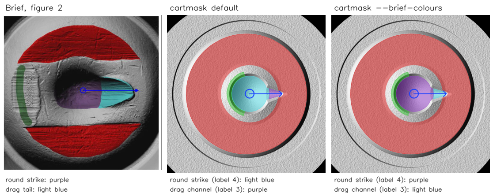
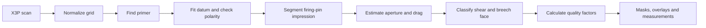

# Segmentation method

The calibrated workflow runs on the **height map**. Physical thresholds use millimetres or micrometres, and ratios express relative geometry. The [pipeline](../src/segment.ts) coordinates the stage modules in [`src/steps/`](../src/steps).

0. **Load and normalise.** Read the X3P, flip to specimen view, area-average to 8 µm/px while ignoring invalid samples. Anisotropic grids are squared.
1. **Primer.** The primer-cup edge drops outward into the primer-pocket gap, so the height gradient there points to the primer centre.
   - A *signed* circular Hough transform votes along the gradient over a physical radius range of 1.5–3.0 mm (small and large pistol primers).
   - Missing data connected to the scan border counts as "low", so scans trimmed to the primer vote with their data edge. Interior dropouts are filled from their neighbours instead, so they don't become fake pits.
   - Refinement: 360 rays, take the steepest outward drop on each, then a robust circle fit.
   - Plausibility re-ranking. On full-head scans, embossed headstamp letters and the primer-pocket gap can produce stronger edge circles than the primer itself. The strongest Hough peak and the next eight separated peaks are refined, then ranked by edge strength × a physical plausibility factor:
     - the visible primer-face diameter must fall within 3.7–5.6 mm when measured case head surrounds the circle. Small pistol primers are 4.45 mm and large pistol primers 5.33 mm nominal; the rounded cup edge makes the visible face slightly smaller (4.05–4.50 mm on the E3 heads). Scans trimmed to the primer are exempt below the range, because there the operator's crop sets the data edge;
     - on full-head scans (valid data at least 8 mm across) the primer must share the case-head axis, the centroid of the head disc, to within 0.75 mm;
     - a crater-like feature (pit, bump or unmeasured hole) must lie inside 0.6 × the radius.
   - The strongest peak is kept whenever it passes all three checks, so trimmed scans and ordinary full heads are unaffected. A re-ranked choice adds a warning.
   - Scans whose field of view is smaller than 3.4 mm, or whose primer lies less than 75 % inside the image, are skipped.
2. **Datum and polarity.**
   - A robust plane fitted to the outer primer face gives `d = z − plane`, the depth below the primer surface.
   - A firing-pin crater must be a pit. A middle dominated by a bump (with no unmeasured hole) can mean a cast or an inverted export, but strong flow-back into the firing-pin aperture raises the middle of a correctly oriented primer in the same way. The heights are flipped only when all three hold:
     1. the centre is dominated by a bump;
     2. the signed primer-edge evidence is stronger with negated heights;
     3. the negated scan yields a plausible crater: less than half the primer face, with a strike circle at most half the primer diameter.
   - When (1) holds but (2) or (3) fails, the heights are kept and the scan is routed to review (`polarity_ambiguous`). On the NIST data this rule removed every flip. Both E3 flips (G0006, G0318) were raised flow-back plateaus, not casts.
   - Roughness (the noise level) is the MAD of the high-pass residual.
3. **Firing-pin impression.**
   - Hysteresis threshold on depth: seeds deeper than `max(2 × edge threshold, 25 % of crater depth)`, grown to the edge threshold `max(10 µm, 5 × roughness, 15 % of crater depth)`.
   - The relative term matters: primers dish around the strike, and a pure noise threshold swallowed the whole dish.
   - Unmeasured holes in the middle of the primer (steep craters confocal scanners cannot see) count as crater. A morphological opening by reconstruction drops thin no-data lines but keeps a hole's full outline, including a narrow drag tip.
4. **Pin-strike circle.** Robust circle fit to the round part of the impression outline. Points beyond 1.15 × the median radius are ignored, so a drag tail does not pull the fit.
5. **Aperture.**
   - *Slot first.* A rectangular firing-pin hole (Glock) leaves a raised flow-back plateau between two long, straight, parallel steps. A signed projection of the height gradient over all directions (a line Hough transform for steps) finds the strongest rising/falling edge pair around the pin. It is a slot only when both edges stand out (score ≥ 10 × the projection noise), the response is direction-selective (≥ 3 × its median over all directions; a round ring scores alike everywhere) and the edges are 0.8–2.2 mm apart. Along the slot the zone follows the raised plateau. The slot replaces the aperture disk, measured impression pixels outside it are dropped (there they are lower primer face, not crater), and the slot edges are kept out of the shear search.
   - Primer metal flows back into the breech-face firing-pin hole and forms a raised ring around the crater. The per-radius median profile around the pin (within the primer face) shows that ring as a peak.
   - The aperture edge is where the profile falls back to 30 % of the peak, capped at 2.1 × the pin radius.
   - Optionally (`aperture_edge=True`), two edge cues are tried when there is no such ring, each needing evidence all around the crater. They are **off by default**: on the NIST scans they move the breech-face boundary of 3 E3 and 10 Lightstone scans, plausibly but without an independent check, and the E3 breech faces are meant to stay stable ([details](aperture-and-shear.md#aperture-edge-cue-available-off-by-default)). The cues are: a wider ring whose fall-off lies within 2.6 × the pin radius and 0.6 × the primer radius and is seen in at least 9 of 12 sectors; or a closed outward down-step (a robust circle through the strongest step on 120 rays, supported by at least half of them and centred on the pin).
   - Otherwise the aperture defaults to 1.5 × the pin radius and the QC score drops. `aperture_evidence` records which source was used.
6. **Drag.** The part of the impression outside 1.1 × the strike circle counts as drag only if all of these hold:
   - it reaches more than 1.15 × the pin radius;
   - its area exceeds 1 % of the pin-strike disk, π·r_c², where r_c is the fitted strike radius;
   - it points one way: the coherence of its direction vectors is above 0.75, so a symmetric moat is rejected.
7. **Aperture shear.**
   - The primer is scraped by the aperture edge as the barrel unlocks: the NIJ/AFTE definition, and Petraco et al. on the mechanism.
   - The same relative motion that drags the pin cuts the shear, so its striations run along the drag axis, and radially through the sheared sector when no drag is detected. A structure tensor on the band-passed depth gives each pixel a striation direction and a coherence. The *oriented texture energy* (texture energy × coherence × alignment with the shear axis) is divided by its breech-face mean, so filing marks that share the direction raise the bar instead of becoming shear.
   - Candidates are connected parts of the aperture band above 2.5 × that mean; with drag only the ±75° sector opposite it is searched. The strongest candidate is accepted when it covers ≥ 0.05 mm², its texture is ≥ 1.4 × (with drag) or 1.6 × (without) the breech-face median, and its own striations are consistent and within 20° of the axis. Accepted candidates grow by hysteresis; `shear_evidence` keeps the measurements and the reason for a rejection.
   - Lightstone (2010) supports the "opposite the drag" rule only partly. With drag oriented at 3 o'clock, shear was found on the left in 83 % of cases but also on the right in 92 %. The implementation limits the search to the opposite sector when it detects drag.
8. **Breech face.** Primer face ∩ valid data − aperture zone − aperture shear.
9. **Quality control.**
   - `qc_score` is the product of five factors, each named and stored in `masks.json`:
     - primer-edge support (fraction of rays that agree);
     - data coverage of the primer face;
     - whether a firing-pin impression was found;
     - whether the crater was measured;
     - whether the aperture came from evidence (a flow-back ring or a slot) rather than the default.
   - Scans scoring below 0.7 or returning a non-`ok` status get `needs_review = true`.
   - Hard gates route a scan to review even when the composite score passes. Each adds a short code to `review_reasons` in `masks.json`:

     | Code | Trigger |
     | --- | --- |
     | `low_qc_score` | Composite score below 0.70 |
     | `status_partial`, `status_skipped`, `status_failed` | No firing pin found, or no usable primer |
     | `crater_unmeasured` | At most 70 % of the impression has measured height |
     | `impression_not_circular` | IoU below 0.85 between the impression and its fitted circle (genuine long drag can also cause this) |
     | `breech_face_too_small` | Breech face below 20 % of the primer face, including zero |
     | `impression_too_large` | Impression at least 50 % of the primer face |
     | `primer_diameter_implausible` | Primer diameter outside the 3.7–5.6 mm prior (data-edge primers are exempt below it) |
     | `polarity_ambiguous` | Central bump, but the flip evidence was insufficient |

   - The gates change routing only. The mask is kept so the reviewer sees what the pipeline produced.

### Colour convention: the brief's figures and ours

Both of the brief's figures colour the **round strike purple** and the **drag tail light blue**. Cartmask's default display does the opposite on purpose:

- **Firing-pin impression, label 4 (light blue):** the round strike crater.
- **Firing-pin shear, label 3 (purple):** the drag channel, the metal the pin sheared while the barrel unlocked. The brief's legend names purple "firing-pin shear", and physically the shearing happens in the channel, not in the round strike.
- **Drag arrow:** from strike centre to channel tip.

To reproduce the brief's figures exactly, pass `--brief-colours` to `npx tsx src/cli.ts`, `npx tsx src/demo.ts` or `python python/image2d.py`. It swaps the two display colours in overlays, flat masks and legends. Label IDs, mask files and the X3P export colours do not change, so downstream code is unaffected.

The figure was drawn from a synthetic dragged strike by `scripts/colour_convention.py` in the Python reference implementation; the display colours are the same constants here (`COLOURS` and `setBriefColours` in [`src/visualize.ts`](../src/visualize.ts)).

## Assumptions

- The calibrated pipeline expects 3D topography (X3P) of a centre-fire case head viewed along the case axis, with the primer at least 75 % inside the field of view.
- One firing-pin impression, inside the primer; a roughly round pin tip (hemispherical or truncated cone).
- Heights are in metres on a regular grid; invalid points are NaN or flagged in the X3P valid-points mask.

## Edge cases handled

| Case | Handling |
|------|----------|
| Scan trimmed to the primer (confocal) | Border-connected missing data counts as "low", so the data edge votes as the primer edge |
| Crater not measured | Holes with a thick core count as crater; QC lowered and the scan flagged |
| Scattered dropouts | Interior holes filled from neighbours before the primer search |
| Field of view too small, or primer outside the image | `status = skipped` with a reason |
| Off-centre primer, tilt, noise, anisotropic grid | Full-image Hough; robust plane; noise-adaptive thresholds; resampling to square pixels |
| Cast or inverted heights | Flip only when the central bump, the primer-edge evidence and the flipped crater all agree; otherwise keep the heights and route to review |
| Primer on a headstamp feature | Candidates re-ranked by diameter prior, concentricity with the case head and a crater inside |
| Primer dished or domed | Impression edge relative to crater depth; aperture needs a real flow-back fall-off |
| No drag | No purple or arrow; aperture shear only where striations run radially and are rougher than the breech face |
| Rectangular (slotted) aperture | Slot detected from two straight parallel steps; replaces the aperture disk; impression clipped to it |
| Exceptions in a batch | Caught per file, with the error type, and written to `summary.csv` |

## Pipeline structure

## 3D parameters

`DEFAULT_PARAMS` in [`src/segment.ts`](../src/segment.ts) defines the defaults. Names are camelCase; `paramsFromPython()` accepts the Python reference's snake_case names (`work_um_per_px` and so on), so parameter files written for the Python version still apply.

| Setting | Default | Purpose |
| --- | --- | --- |
| `workUmPerPx` | 8 µm/px | Square working-grid spacing |
| `primerRadiusMm` | 1.5–3.0 mm | Radius range covered by the primer search |
| `primerDiameterPriorMm` | 3.7–5.6 mm | Plausible visible primer-face diameter when case head surrounds it |
| `minFieldOfViewMm` | 3.4 mm | Minimum scan extent along the shorter axis |
| `minPrimerInside` | 0.75 | Required fraction of the primer within the scan |
| `rimMarginFrac` | 0.05 | Fraction of radius excluded at the cup rim |
| `fpiMinDepthUm` | 10 µm | Absolute lower bound for the impression-edge threshold |
| `fpiNoiseK` | 5 | Roughness multiplier for that threshold |
| `fpiRelDepth` | 0.15 | Crater-depth multiplier for that threshold |
| `fpiSeedFrac` | 0.25 | Crater-depth multiplier for hysteresis seeds |
| `apertureMaxRatio` | 2.1 | Largest aperture radius relative to the pin radius |
| `apertureFall` | 0.30 | Relative radial-profile height at the aperture edge |
| `apertureDefaultRatio` | 1.5 | Fallback aperture radius relative to the pin radius |
| `dragMinReach` | 1.15 | Minimum drag reach relative to the pin radius |
| `dragMinAreaFrac` | 0.01 | Minimum drag area relative to the pin-strike disk, π·r_c² |
| `dragMinCoherence` | 0.75 | Minimum directional coherence of tail pixels |
| `shearSectorDeg` | 75° | Half-angle of the search sector opposite the drag |
| `shearTextureK` | 1.4 | Relative roughness of an accepted shear candidate, with drag |
| `shearNodragK` | 1.6 | Relative roughness of an accepted shear candidate, without drag |
| `shearOrientedK` | 2.5 | Oriented texture energy over its breech-face mean, for shear candidates |
| `shearAxisTolDeg` | 20° | Largest angle between candidate striations and the shear axis |
| `shearStriationUm`, `shearTensorUm` | 24 µm, 48 µm | Structure-tensor band-pass and window |
| `rectMinScore`, `rectMinAnisotropy` | 10, 3 | Slot-edge strength and direction selectivity |
| `rectWidthMm` | 0.8–2.2 mm | Plausible slot width |
| `apertureEdge` | off | Enables the aperture-edge cues below |
| `apertureEdgeK`, `apertureEdgeMinCover` | 4, 0.5 | Edge-step strength and ray support |
| `apertureRingMaxPrimer`, `apertureRingMinCover` | 0.6, 0.75 | Wide-ring limits |
| `qcReviewBelow` | 0.70 | Scores below this threshold trigger review |

## Output coordinates

- X3P rows are flipped into specimen view when loaded, so headstamps read correctly.
- `labels.png` uses working-grid pixels. Labels are 0 background, 1 breech face, 2 aperture shear, 3 firing-pin shear and 4 firing-pin impression.
- X3P export maps labels back to the native raster and restores the input row order.
- Image angles increase clockwise. Zero degrees points right. Drag length runs from the strike centre to the tail tip, including the pin radius. The canonical preview rotates the drag toward six o'clock.
